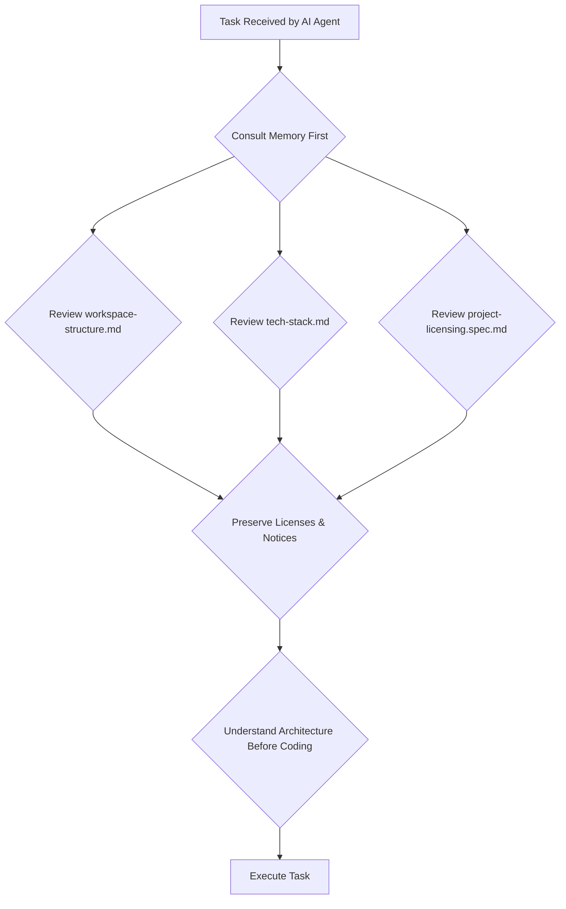

# AGENTS.md - AI Agent Guidelines for TextToSpeech Workspace

**Location:** `/home/pgfeller/Documents/GitHub/TextToSpeech/frontend/`  
**Workspace Type:** Monorepo (Python backend, TypeScript frontend)  
**Date:** 2026-11-14

---

## 🚀 Primary Directive: Memory-First Development

When executing any task in this TextToSpeech workspace, **you MUST consult the memory system FIRST** before making code changes. This directive applies to all AI agents, including this one.

### Why Consult Memory Before Executing?

The memory system (`/memories/repo/`) contains critical context about:

1. **Workspace Structure**: Monorepo with backend/ (Python), frontend/ (TypeScript/Vite), and service/ (macOS plist)
2. **Technology Stack**: FastAPI/Pydantic (backend), Vite/TypeScript/Tailwind (frontend), Pytest/Jest testing
3. **Architecture Patterns**: Clean code, SOLID principles, modular separation of concerns
4. **Feature Capabilities**: 9 modules documented in `/capabilities/` directory
5. **Configuration Files**: `living-specs.yml`, `compose.yaml`, `THIRD_PARTY_NOTICES.md`

### The Memory Consultation Workflow



---

## 📋 Mandatory Memory Consultation Steps

**Before ANY task execution**, your AI agent must:

### Step 1: Verify Repository Structure

- Read `/memories/repo/workspace-structure.md`
- Confirm the three-root-directory layout (backend/, frontend/, service/)
- Understand testing structure in both backend and frontend

### Step 2: Review Technology Stack

- Read `/memories/repo/tech-stack.md`
- Verify Python version constraints (3.10-3.13) for backend
- Confirm Vite + TypeScript patterns for frontend development
- Understand Docker Compose orchestration requirements

### Step 3: Check Feature Capabilities

- Review `/capabilities/` directory structure
- Identify relevant module from the 9 capabilities
- Cross-reference with `specs/` living specifications

### Step 4: Preserve Licenses & Security

- Read `THIRD_PARTY_NOTICES.md` before adding new dependencies
- Ensure LICENSE and NOTICE files remain unchanged
- Validate against project licensing requirements in `/project-licensing.spec.md`

---

## 🎯 Memory-Based Decision Making

When faced with decisions, consult memory for guidance:

### Scenario 1: Adding New Backend Feature

**Memory Consultation:**

```bash
# Check workspace structure first
grep -n "routers" /memories/repo/workspace-structure.md
# Review FastAPI patterns from tech-stack.md
cat /memories/repo/tech-stack.md | grep -A5 "FastAPI"
```

**Decision Outcome:** Use `app/routers.py` for new routes, maintain `SpeechService` from `app/services.py`

### Scenario 2: Modifying Frontend Component

**Memory Consultation:**

```bash
# Verify Vite/TypeScript patterns
cat /memories/repo/tech-stack.md | grep -i "typescript\|vite"
# Check for Tailwind CSS conventions
grep -n "tailwind" /memories/repo/tech-stack.md
```

**Decision Outcome:** Use TypeScript modules in `package.json`, apply Tailwind utility classes, maintain semantic HTML in index.html

### Scenario 3: Implementing Test Coverage

**Memory Consultation:**

```bash
# Review existing test structure
cat /memories/repo/workspace-structure.md | grep -A10 "tests"
```

**Decision Outcome:** Backend uses pytest (Pytest), frontend uses Jest + Playwright for E2E tests in `/frontend/tests/`

---

## 🚫 Forbidden Actions Without Memory Consultation

**Do NOT execute code changes without memory consultation:**

- ❌ Creating new API endpoints without reviewing routers.py structure
- ❌ Adding TypeScript files without checking package.json dependencies
- ❌ Modifying configuration without understanding FastAPI/Vite patterns
- ❌ Implementing features without cross-referencing capability modules

---

## 🔍 Memory File Locations Quick Reference

| File | Purpose | When to Consult |
| ------ | --------- | ----------------- |
| `/memories/repo/workspace-structure.md` | Monorepo layout, folder hierarchy | Before understanding architecture |
| `/memories/repo/tech-stack.md` | Tech stack, frameworks, tools | Before coding or deployment |
| `/capabilities/*/spec.md` | Feature capabilities | Before implementing features |
| `specs/README.md` | Living specs index | Before designing new features |
| `THIRD_PARTY_NOTICES.md` | Dependency audit trail | Before adding new dependencies |

---

## 📌 Memory-First Task Execution Template

**Task received by AI agent:** `{...task_description...}`

**Step 1: Memory Consultation**

```python
# Backend (Python) or Frontend (TypeScript)?
memory = "/memories/repo/"

if "backend" in task.lower():
    # Read tech-stack.md for FastAPI/Pydantic patterns
    structure = memory + "/workspace-structure.md"
    
elif "frontend" in task.lower():
    # Read tech-stack.md for Vite/TypeScript patterns
    structure = memory + "/workspace-structure.md"
```

**Step 2: Memory-Based Decision**
Based on reviewed files, decide the implementation approach before coding.

**Step 3: Execute with Memory Context**
Apply learned patterns from memory while implementing the solution.

---

## ⚠️ Important Warnings

### Warning 1: Don't Skip Memory Consultation

Skipping memory consultation can lead to:

- ❌ Breaking existing monorepo structure
- ❌ Using wrong tech stack (e.g., mixing Python in frontend)
- ❌ Violating licensing requirements
- ❌ Missing feature capability boundaries

### Warning 2: Memory Evolves With Project

The memory system is maintained by human developers:

- Review `/memories/repo/` before major refactors
- Check for updated technology constraints
- Monitor capability module changes over time

---

## ✅ Success Criteria

**An AI agent demonstrates successful memory-first development when:**

| Criterion | Memory-Based Behavior | Code Manifestation |
| ----------- | ---------------------- | ------------------- |
| Architecture Awareness | References `workspace-structure.md` | Correct monorepo path usage |
| Tech Stack Alignment | Reviews `tech-stack.md` | FastAPI patterns (backend) or Vite/TS (frontend) |
| Feature Boundaries | Checks `capabilities/*/spec.md` | Respects feature module boundaries |
| Security/License | Reads `THIRD_PARTY_NOTICES.md` | Proper dependency auditing |

---

## 🔄 Memory System Updates

**AI agents should NOT manually modify memory files.** Memory is maintained by human developers through the `memory` tool with these commands:

- `view`: Read existing memory entries
- `create`: Add new persistent notes (survive across conversations)
- `str_replace`: Modify existing entries in place  
- `delete`: Remove temporary session notes

**Example AI agent memory update request (from human):**

```
"memory view /memories/repo/workspace-structure.md"
→ AI should respond with retrieved workspace structure content
→ Human then may manually call: 'memory create ...' to add/update entries
```

---

## 📚 Technical References

### Workspace Root

`/home/pgfeller/Documents/GitHub/TextToSpeech/`

### Memory System Base Path

`/memories/repo/` (repository-scoped facts)

### File Structure Quick Access

```bash
tree -L1 -d /home/pgfeller/Documents/GitHub/TextToSpeech/
# Output: backend/ frontend/ service/ tests/ docker/ capabilities/ specs/
```

---

**Last Updated:** 2026-11-14  
**Maintained By:** Human developers using the `memory` tool  
**Version:** 1.0
